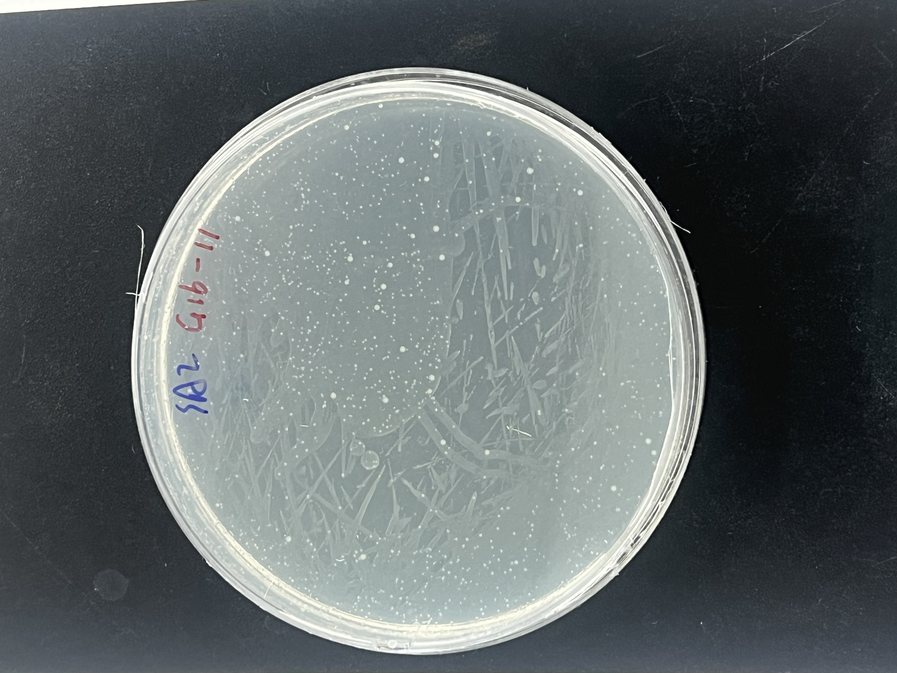
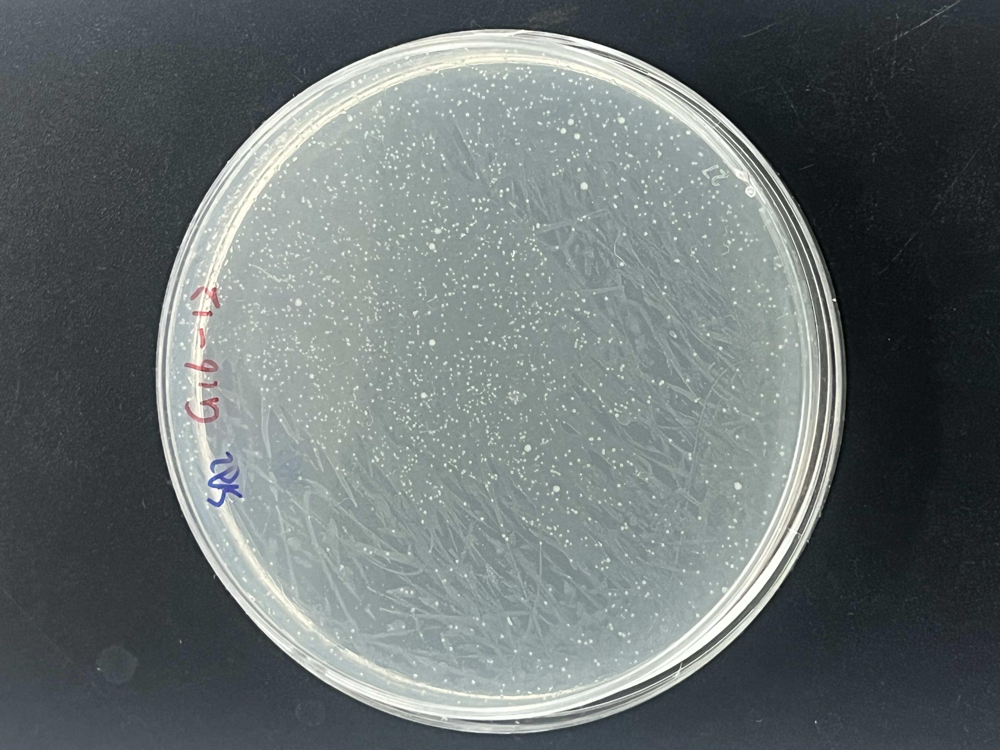
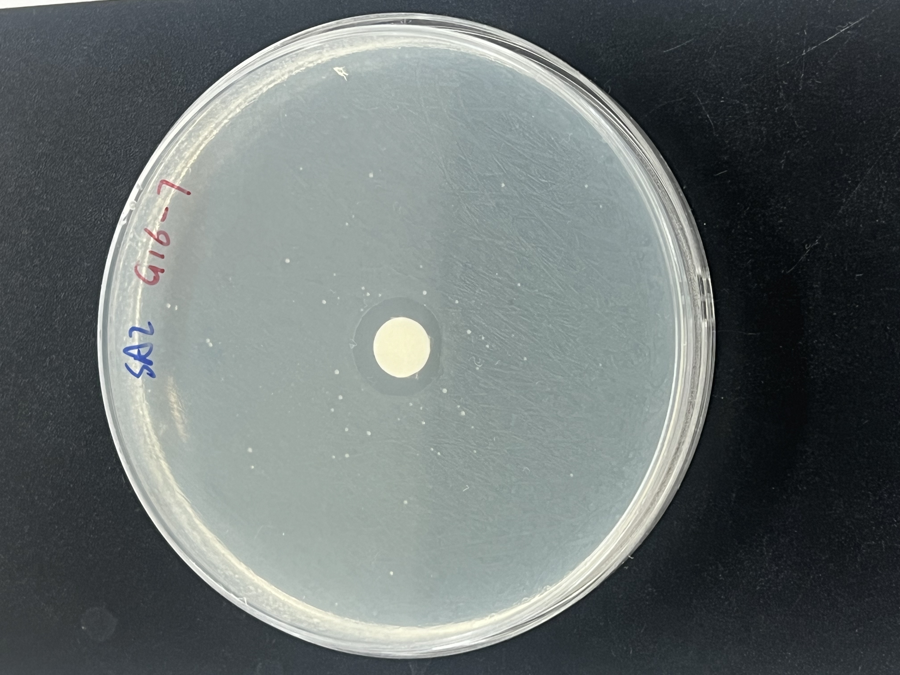
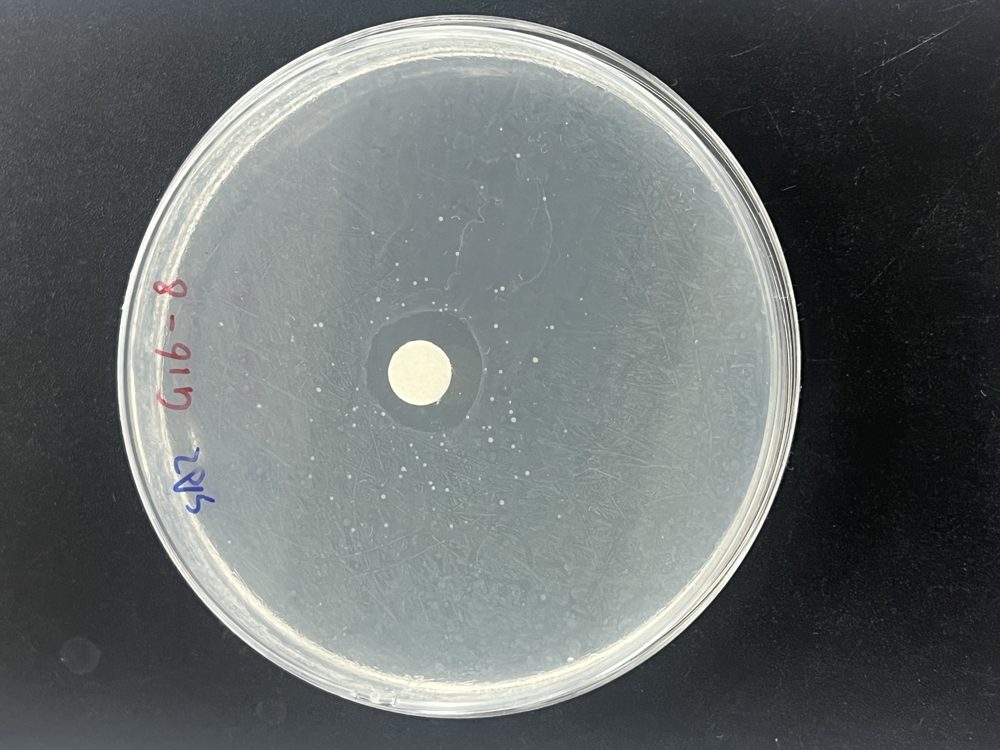
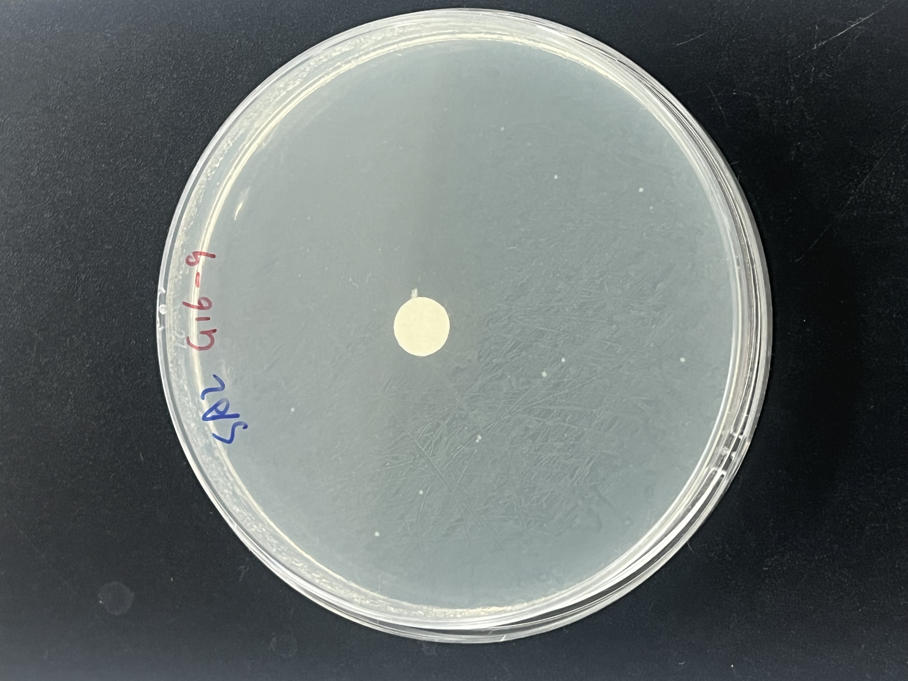
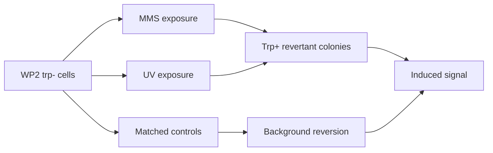

<div align="center">


[](https://github.com/Ci-yo/BIO204-Lab2-Bacterial-Mutagenesis/actions/workflows/repository-check.yml)


**Twelve plates, two mutagens and one question: when does DNA damage become a visible mutation signal?**

</div>

## Reading mutation without sequencing

The WP2 assay starts with an *E. coli* strain that cannot grow without tryptophan. A reverse mutation restores the Trp⁺ phenotype, turning each colony on selective medium into a visible readout of mutagenesis.

| Untreated SA2 | UV 20 s | UV 40 s |
|---:|---:|---:|
| 14 colonies | 911 colonies | >1,000 colonies |

The visual jump is hard to miss: UV exposure produced the strongest reversion signal in this experiment.

|  |  |
|---|---|
| **20 s UV** | **40 s UV** |

## The MMS diffusion fingerprint

MMS tells a more spatial story. In a spot test, the chemical diffuses away from a central disc. Mutagenic stimulation and local toxicity can therefore appear on the same plate.

| 1% MMS | 2% MMS | Water control |
|---|---|---|
|  |  |  |
| 46 colonies | 73 colonies | 11 colonies |

The 2% plate produced more revertants than the 1% plate, but the concentration gradient means these images are better for **qualitative dose-response interpretation** than exact mutation-frequency estimation.

## Quantitative snapshot

Plate 6 was used for the viable-cell estimate because its 276 colonies fell within the countable range. This gave an estimated starting density of **2.76 × 10⁹ CFU/mL** and approximately **2.76 × 10⁸ cells plated** on each undiluted assay plate.

| Comparison | Induced mutation frequency |
|---|---:|
| MMS liquid treatment | 3.62 × 10⁻⁹ |
| MMS spot, 1% | 1.16 × 10⁻⁷ |
| MMS spot, 2% | 2.14 × 10⁻⁷ |
| UV, 20 s | 3.25 × 10⁻⁶ |
| UV, 40 s | >3.57 × 10⁻⁶ |

These values are not perfectly interchangeable: MMS liquid treatment used SA1, whereas the UV plates used SA2, and the UV colonies were too dense for precise counting.

## Experimental logic



## Reproduce the calculations

```bash
Rscript scripts/calculate_mutation_frequencies.R
Rscript scripts/validate_repository.R
```

## Repository map

```text
├── data/       plate conditions and colony counts
├── figures/    selected plate photographs
├── results/    mutation-frequency calculations
└── scripts/    analysis and validation
```

---

<div align="center">

**BIO204 Lab 2 · mutation made visible on a plate**

</div>
